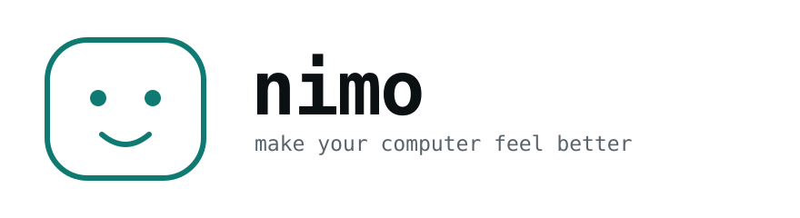

<div align="center">

<a href="https://danielkopa.github.io/nimo/">
  <picture>
    <source media="(prefers-color-scheme: dark)" srcset="assets/nimo-dark.svg">
    
  </picture>
</a>

**Make your workspace clean.**

A clear desktop, a dock with only what you open, a calmer wallpaper, and the
disk back. Every step asks first. Every step can be undone.

[Website](https://danielkopa.github.io/nimo/) ·
[Docs](#commands) ·
[Changelog](CHANGELOG.md) ·
[Issues](https://github.com/danielkopa/nimo/issues)

[](https://github.com/danielkopa/nimo/actions/workflows/ci.yml)
[](https://github.com/danielkopa/nimo/releases)


[](LICENSE)

<br>



</div>

## What is nimo?

nimo is a command line tool for the parts of a computer that quietly get away
from you: eighty-five things on the desktop, three hundred in Downloads, a dock full
of apps Apple put there, a wallpaper you never chose.

It is one bash script and fourteen small libraries. No dependencies, no daemon,
no account, no network. You can read the whole thing in fifteen minutes, which
is the point — a tool that rearranges your files is a tool you should be able
to read.

Nothing in that demo is deleted. Files move into one folder, sorted by what they are,
and every single move is written down — so `min undo` puts any of it back
exactly where it was.

### The face

It draws itself in, a row at a time, and blinks once — four hundred
milliseconds in all, only when there is a terminal to draw on and nobody has
asked for quiet. `--no-animation`, or `animation = off` in `~/.nimo/config`,
turns it off for good.

## Getting started

```bash
brew install danielkopa/tap/nimo
```

or, to have the source where you can read it:

```bash
git clone git@github.com:danielkopa/nimo.git ~/nimo && ~/nimo/install.sh
```

Then type `min`. Or `min preview` first, which cannot change anything at all.

There is deliberately no `curl … | bash` line. nimo's whole argument is that
you can read it before you run it, and that line is the opposite of that.

## Why nimo

Cleaners ask you to trust a binary with your disk. nimo asks you to trust four
hundred lines of shell you can read over a coffee, and then holds to six rules
it cannot quietly break, because there are tests standing on all of them:
nothing without a yes, everything undoable, only inside your home folder, no
sudo, no network, and the number it shows you is the number you get.

## The way in

`min` on its own is a prompt. Type what you want:

```
   ███╗   ██╗██╗███╗   ███╗ ██████╗
   ████╗  ██║██║████╗ ████║██╔═══██╗
   ██╔██╗ ██║██║██╔████╔██║██║   ██║
   ██║╚██╗██║██║██║╚██╔╝██║██║   ██║
   ██║ ╚████║██║██║ ╚═╝ ██║╚██████╔╝
   ╚═╝  ╚═══╝╚═╝╚═╝     ╚═╝ ╚═════╝

   make your computer feel better

  type a command, or / to see them all. ctrl-d to leave.

  nimo › /clear
  nimo › /wallpaper
  nimo › /undo
```

`/clear` asks what should be clear and counts each one as it asks, so the menu
itself shows you where the mess actually is:

```
   ▸ Desktop        85 items
     Downloads      296 items
     Screenshots    12 screenshots loose
     Dock           the apps you never open
     Trash          18 items
     Disk           caches your apps rebuild by themselves
     Everything     all of it, one step at a time
``` Say it outright if you prefer:
`/clear desktop`, or `/cleardesktop`.

The slash is optional, the spaces are optional, and so is remembering the exact
word: `/desktop`, `/cleardesktop`, `/clear desktop`, `/clearfiles` and
`/sort desktop` all mean the same thing. Typos are caught
by shared prefix rather than substring, so `/wallpapr` and even
`/clean deskopt` are understood — nimo says what it thinks you meant and waits
rather than guessing on your behalf.

### Saying yes once

Every command asks before it changes anything, which is right the first few
times and wearing by the twentieth. `/auto` is the same bargain a terminal
agent offers: you say yes once, deliberately, knowing what it covers, and then
nothing asks again until you leave.

```
  nimo › /auto

  yes to everything

    nimo stops asking. Every command runs the moment you type it.

    this covers this session only — it is off again next time
    undo still works for everything that has one:  /undo
    the trash is the exception. /empty has no undo, auto or not.

  Stop asking for the rest of this session? [y/N] y

  nimo auto › _
```

The prompt says `auto` for as long as it is on, so you always know which one
you are in. `/auto off` puts the questions back, and leaving does too.
`NIMO_AUTO=1 min` starts there, and `-y` does the same for one command.

Flags work at the prompt too: `/clean --only trash`, `/desktop --undo`.
`/menu` switches to picking with the arrow keys, and `min --menu` starts there.

Piped into anything, `min` prints the help it always did.

Piped into anything, or in a terminal that cannot do it, the same `min` prints
the help it always did.

## A minimal mac

### `min desktop`

Everything on your desktop moves into `Desktop/Tidy/`, sorted by what it is —
Screenshots, Images, Documents, Video, Audio, Archives, Code, Folders, Other.

```
  ╭─ your desktop ────────────────────────────────────

     Screenshots                     23 items
     Images                          11 items
     Documents                        8 items
     Archives                         3 items
     Folders                          2 items

     ─────────────────────────────────────────
     On your desktop                 47 items

  ╰────────────────────────────────────────────────────

  everything moves into  Desktop/Tidy/<kind>/
  nothing is deleted, nothing is renamed
```

By default they are grouped by what they are. `--by letter` files them under
A, B, C — and `#` for anything that does not start with one — and `--by date`
files them by the month they were last touched. Sorting four hundred invoices
by kind puts four hundred things in one folder; by letter or by month, they
land somewhere you can actually look.

Nothing is deleted. Nothing is renamed — if a name is already taken, the new
file becomes `invoice 2.pdf`. Hidden files are left alone, and so is anything
still arriving: a `.download`, `.crdownload`, `.part` or `.partial` is a file a
browser is still writing, and moving it out from under the browser breaks the
download. Every single move is
written down in `~/.nimo/undo/`, so:

```bash
min desktop --undo
```

puts all forty-seven back exactly where they were, down to the folder.

### `min downloads` · `min screenshots`

`min downloads` is the same sorter pointed at `~/Downloads` — the folder that
quietly reaches three hundred items while you are not looking. Same rules, same
undo log, same `--undo`.

`min screenshots` gathers every loose screenshot out of your desktop, downloads
and documents into `~/Pictures/Screenshots`. It only touches files it
recognises as screenshots, by name, and puts them all back with
`min screenshots --undo`.

### `min dark` · `min hide`

Two switches, both preferences, both written down before they are touched and
both reversible with `min setup --restore`. `min dark` flips the appearance
(`min light` flips it back); `min hide` lets the menu bar slide away until you
reach for it.

### `min duplicates`

The same file, kept in three places. nimo groups by size first — two files of
different sizes cannot be the same file — and only reads the handful of
candidates left over. It reports them and stops there: it cannot know which
copy you meant to keep, so it does not choose.

### `min apps` · `min empty`

`min apps` asks macOS when you last opened each app and lists the ones you have
not touched in six months, biggest first. It reports and stops — it does not
uninstall anything, because that is not a decision a script should make. Drag
the ones you agree with to the Trash, then `min empty` takes it out and tells
you what that was worth.

### `min blank` · `min dock --fast`

`> notes.txt` in a shell empties a file in a keystroke and there is no way back
from it. `min blank notes.txt` does the same thing, except it puts a copy of the
contents in `~/.nimo/undo` first — so emptying a document becomes a decision you
can change your mind about, like everything else here. If the copy cannot be
made, the file is not emptied.

`min dock --fast` removes the wait before the dock slides and shortens the slide
itself, which is the difference between a dock that hides and a dock that keeps
up. Both settings are written down first, so `min setup --restore` puts the
sluggish ones back.

### `min zen`

The fastest calm desktop there is: Finder stops drawing icons on it. Nothing
moves, nothing is deleted, everything is still in `~/Desktop` and still in
Finder. `min zen --restore` brings the icons back.

### `min dock`

nimo lists what is in your dock, marks the ones Apple put there, and asks which
numbers should go. It never decides for you.

```
  ╭─ your dock ───────────────────────────────────────

      1  Finder
      2  Safari
      3  Mail
      4  Freeform                  came with macOS
      5  TV                        came with macOS
      6  Terminal

  ╰────────────────────────────────────────────────────

  Numbers to remove, separated by spaces (enter keeps everything):
```

In a real terminal that list is a picker: **↑↓** to move, **space** to tick,
**a** for all, **n** for none, **enter** to confirm, **q** to cancel. Piped
into a script, or in a terminal that cannot do it, the exact same question is
asked by typing numbers instead. Nothing ever becomes impossible, only less
pleasant.

The apps stay installed — only the icons go. Your whole dock is exported first,
so `min dock --restore` brings back exactly what you had.

### `min wallpaper`

The wallpapers macOS already ships with, listed, with nimo's own pick marked.
Nothing is downloaded. `--random` if you cannot decide, `--restore` to go back.

### `min undo`

Everything nimo has ever done, in one list, newest first. Pick a line and that
change is reversed — that desktop tidy, that dock, that wallpaper. Nothing else
is touched.

```
  ╭─ what nimo has done ──────────────────────────────

   ▸ cleared your desktop   26.08.2026 16:44   47 files
     rebuilt your dock      26.08.2026 16:41
     changed your wallpaper                    back to Sonoma

  ╰────────────────────────────────────────────────────

  ↑↓ move   enter reverse   q cancel
```

This is the reason nimo is allowed to touch anything at all.

### `min setup`

Preferences only — `defaults write`, the same thing you would type by hand. No
files touched, no sudo. `min setup --dry-run` shows every command first.

| group | what |
| --- | --- |
| `finder` | show extensions, path bar, list view, folders first |
| `dock` | auto-hide instantly, no recent apps, smaller icons |
| `screenshots` | save to `~/Desktop/Screenshots` as png, no drop shadow |
| `keyboard` | fast key repeat, hold a key to repeat it |
| `dialogs` | always expand save and print panels |

## And then the disk

### `min preview` · `min clean`

```
  ╭─ safe to clean ───────────────────────────────────

     App caches                        4.2 GB  your apps rebuild them
     Xcode derived data                8.7 GB  rebuilt on your next build
     Trash                             1.1 GB  already thrown away
     npm / yarn / pnpm cache           812 MB  download caches

     ─────────────────────────────────────────
     Total                            15.0 GB
     Disk         231 GB free of 494 GB

  ╰────────────────────────────────────────────────────

  ╭─ worth a look ────────────────────────────────────

     nimo never deletes anything in this section

     node_modules folders              6.4 GB  23 items · npm install brings them back
     Old downloads                     2.9 GB  41 items · untouched for a while
     iPhone / iPad backups              11 GB  2 items · losing these loses backups

  ╰────────────────────────────────────────────────────
```

`min preview` cannot delete anything. `min clean` runs the same scan and then
asks. Everything in **safe to clean** is a cache your apps rebuild by
themselves: `user-caches`, `logs`, `crash-reports`, `trash`, `quicklook`,
`mail-downloads`, `xcode`, `homebrew`, `node`, `python`.

Everything in **worth a look** is measured and shown and never touched, not
even with `--yes`: `downloads`, `ios-backups`, `xcode-archives`,
`device-support`, `node-modules`, `big-files`.

### `min top` · `min doctor`

`min top` ranks the biggest things in your home with bars — and in a terminal you can step into them: pick the folder that is too big, see what is inside it, and keep going until you find the thing. `..` comes back up, `q` stops, and it goes no further up than your home folder. It only ever measures. `min doctor` puts
disk, uptime, desktop clutter and total junk on one screen. Neither one changes
anything.

## Commands

| Command | What it does |
| --- | --- |
| `min clear` | pick what should be clear — desktop, downloads, screenshots, dock, disk |
| `min tidy` | desktop, downloads, screenshots, dock, wallpaper and preferences, in order |
| `min desktop` | clear your desktop — `--undo` puts it back |
| `min downloads` | the same sorter, pointed at `~/Downloads` |
| `min screenshots` | gather every loose screenshot into `~/Pictures/Screenshots` |
| `min zen` | stop drawing icons on the desktop at all — `--restore` brings them back |
| `min dark` · `min light` | switch appearance |
| `min hide` | let the menu bar slide away — `--restore` brings it back |
| `min duplicates` | the same file, kept more than once — reported, never deleted |
| `min apps` | what you installed once and never opened again |
| `min empty` | take the trash out |
| `min blank FILE` | empty a file, keeping what was in it — `min undo` puts it back |
| `min dock --fast` | no wait before the dock slides, and a quick slide |
| `min dock` | pick what stays — `--restore` puts it back |
| `min startup` | what launches when you sign in, and stop the ones you tick |
| `min wallpaper` | flip through the ones your system has, live — `--restore` puts it back |
| `min next` / `min prev` | one step through them, applied straight away |
| `min undo` | everything nimo has done, and a way back |
| `min clean` | free up the caches, after asking |
| `min preview` | the same scan, unable to delete |
| `min top` | the biggest things in your home — step into them |
| `min doctor` | how your computer is doing |
| `min setup` | a small, sane set of macOS preferences |
| `min update` | pull the newest nimo |
| `min help` · `min version` | the basics |

## Options

| Option | Meaning |
| --- | --- |
| `-n`, `--dry-run` | show what would happen, change nothing |
| `-y`, `--yes` | skip the confirmation question |
| `--auto` | yes to everything, including in the prompt |
| `--undo` | put your desktop back the way it was |
| `--restore` | put the dock or the wallpaper back |
| `--random` | let nimo pick the wallpaper |
| `--menu` | pick from a list with the arrow keys |
| `--fast` | with `min dock`: no wait, and a quicker slide |
| `--list` | list what a command offers, without asking anything |
| `--only a,b` | limit to certain items or setup groups |
| `--days N` | what counts as an old download (default 30) |
| `--limit N` | how many rows `min top` shows (default 15) |
| `--by WHAT` | sort by `kind` (default), `letter`, or `date` |
| `--json` | machine readable output for `clean` and `preview` |
| `--color` | colour even when piped |
| `--no-color` | plain output |
| `--no-animation` | no drawing itself in, no blink |
| `-q`, `--quiet` | no banner |
| `-h`, `--help` | show the help |
| `-v`, `--version` | show the version |

Every menu falls back to typing a number where the arrow keys cannot work — a
pipe, a script, ssh with no tty, `TERM=dumb`. The list is the same list; it is
printed and numbered instead of drawn.

## Rules nimo follows

- **Nothing happens without a yes.** Every command that changes something
  shows you what it is about to do and waits — unless you have said yes to the
  whole session with `/auto`, which is itself a yes, given once and shown in
  the prompt the entire time it lasts.
- **Everything is undoable.** Desktop moves are logged file by file. The dock
  is exported before it is touched. The old wallpaper is written down.
- **Only inside your home folder.** nimo refuses any path outside `$HOME`, and
  refuses `$HOME` itself, `/`, `/System`, `/Applications` and friends. The
  guard is in `lib/core.sh`, and every path is reduced to one spelling before
  it is compared: `$HOME/.`, `$HOME//` and `$HOME/./` are all `$HOME`, because
  a glob does not know that and what runs next empties whatever it is handed.
  A `$HOME` that is empty, or not an absolute path, means nimo deletes nothing
  at all rather than guessing. Links are never followed — a cache folder moved
  to another disk is a link, and `find dir/` walks straight through one.
  Twenty-nine checks in the suites are nothing but attempts to get around
  this, each one a spelling of your own home folder.
- **No sudo. Ever.** On Windows, nothing under HKLM and nothing that asks for
  an administrator.
- **Nothing is downloaded.** Wallpapers come from what your system ships with.
- **The number you see is the number you get.** After cleaning, nimo measures
  again and reports what was actually freed.

## Configuration

Optional. `~/.nimo/config`, one `key = value` per line:

```
days  = 60
limit = 25
jobs  = 8
color = never
tidy  = Desktop Tidy
```

It is **read, not sourced** — nothing in that file can run as code, whatever
ends up in it. Anything typed on the command line still wins.

## Speed

Measuring is almost entirely waiting on the disk, so nimo measures six places
at a time instead of one after another. On a Mac with a large
`~/Library/Caches` and an Xcode folder that is the difference between a scan
you wait for and a scan you do not. `jobs` in the config changes how many.

## Manual page

`./install.sh` puts one where your system keeps them:

```bash
man min
```

## Tests

```bash
bash test/run.sh      # everything that runs anywhere
bash test/macos.sh    # the parts that only run on a Mac
bash test/windows.sh  # the parts that only run on Windows

bash test/run.sh -q   # only what went wrong, and the verdict
```

The dock, the wallpaper, the preferences and the registry only ever run on one
system each, which used to make them the parts nobody could test.
`test/macos.sh` and `test/windows.sh` stand fake `defaults`, `osascript`,
`plutil`, `launchctl`, `killall`, `sw_vers`, `pmset`, `sqlite3`, `reg`,
`powershell` and `uname` in front of the real ones and run the real nimo code
against them — on any machine, without touching a real dock, a real wallpaper
or a real registry. They check that the right apps leave the dock and the rest
keep their order, that the backup is written *before* anything changes, that
`--restore` brings all of it back, that `setup --dry-run` writes nothing at
all, that no line anywhere reaches for sudo, that a value nimo invented is
unset again and not merely overwritten, and that the wallpaper can still be
set on a Mac that refuses AppleScript outright.

They keep finding real bugs, and these are the ones worth knowing about:

- `pmset` says `discharging`, which contains `charging`, so a battery on its
  way down was reported as plugged in
- the guard meant to spot a structured preference value used
  `"$(printf '\n')"`, which collapses to an empty string — so it matched every
  value and nothing was ever recorded
- two runs inside one second produced the same log name, and the second
  truncated the first, taking the only record of how to undo it with it
- Apple's own AppleScript returns success on some systems while changing
  nothing at all, and nimo printed a tick on "it did not error". The suite can
  now be told to lie in exactly that way
- a registry key is full of backslashes, so `grep` reads `\S` and `\W` as
  patterns of its own — and `awk -v` expands the escapes on the way in, so the
  key has to arrive through `ENVIRON`

Every push runs everything on GitHub Actions: ShellCheck, a parse on both bash
3.2 and bash 5, all three suites on Linux, **all three on macOS under
`/bin/bash` — the actual 3.2 that ships with macOS** — the Linux and Windows
suites on a real Windows machine in the bash Git ships, and an
install-then-uninstall round trip on both macOS and Windows. The bash 3.2
claim in this README is not a claim; it is a job that fails if it stops being
true.

`test/run.sh` runs against a fake computer in `/tmp` with its own fake `HOME`:
every command and flag, the safety guard — and every spelling of your own home
folder that might get around it — the arrow-key picker driven by simulated
keystrokes, the menu, the undo history, the config file, seventeen file names
with quotes and globs and command substitutions in them, the desktop sorted and
then fully undone, and a complete clean where the promised number is compared
against the freed number. Your real files are never read, never measured, never
touched.

## Scripting

```bash
min preview --json | jq '.safe_bytes'
min clean --json --yes | jq '.freed_bytes'
```

## Tab completion

```bash
echo 'source ~/nimo/completions/min.bash' >> ~/.zshrc
```

That is the whole thing — zsh needs `bashcompinit` to run bash completions,
and the file loads it itself. If the shell cannot do completions at all it
does nothing rather than printing an error at you every time you open a
terminal.

## Layout

```
nimo
├── min                    the command itself: flags, dispatch, help
├── install.sh             puts min on your PATH
├── uninstall.sh           takes it off again
├── .github/workflows      shellcheck, bash 3.2, linux, macos, install
├── docs/index.html        the website, in one file
├── completions/min.bash   tab completion
├── man/min.1              the manual page
├── test/run.sh            the suite that runs anywhere
├── test/macos.sh          the macOS parts, against a fake macOS
├── test/windows.sh        the same, against a fake Git Bash
└── lib
    ├── ui.sh              banner, panels, bars, the way output looks
    ├── core.sh            sizes, disk, config, the safety guard
    ├── pick.sh            choosing things with the arrow keys
    ├── repl.sh            the prompt, and what it understands
    ├── desktop.sh         the sorter behind desktop, downloads and screenshots
    ├── dock.sh            reading and rebuilding the dock
    ├── wall.sh            the wallpaper
    ├── look.sh            appearance and the menu bar
    ├── dupes.sh           the same file, more than once
    ├── apps.sh            unused apps, and the trash
    ├── undo.sh            the history, and the way back
    ├── scan.sh            every place nimo knows how to look
    ├── clean.sh           scan, report, clean, json
    ├── setup.sh           the macOS preferences
    └── tools.sh           tidy, top, doctor, update
```

Teaching nimo about a new place to scan is one call to `nimo_register` in
`lib/scan.sh`:

```bash
nimo_register slack "Slack cache" contents safe \
    "rebuilt when Slack starts" \
    "$HOME/Library/Application Support/Slack/Cache"
```

## Windows and Linux

The desktop, the downloads, the screenshots, the duplicates, the disk and the
prompt all work anywhere bash does.

On **Windows** — Git Bash, MSYS2 or Cygwin — `$HOME` is already
`C:/Users/<name>`, so the rule that keeps nimo inside your home folder holds
there with nothing widened for the occasion. It finds the Desktop after Windows
has moved it into OneDrive, looks for junk under `AppData` rather than
`~/Library`, and leaves the Recycle Bin to Windows, because that is an index as
well as a folder and half-deleting it helps nobody. `test/windows.sh` runs the
real code against a faked Git Bash, and CI runs it on a real Windows machine
too.

**WSL is deliberately treated as Linux.** Its home is a Linux home; your
Windows files live outside it, and reaching over there would mean loosening the
one rule this tool will not loosen.

What runs where, exactly:

| | macOS | Windows | Linux |
| --- | --- | --- | --- |
| `desktop` `downloads` `screenshots` `blank` `undo` | yes | yes | yes |
| `clean` `preview` `top` `doctor` `duplicates` `empty` | yes | yes | yes |
| `wallpaper` `dark` `light` `zen` `setup` `hide` `apps` `startup` `dock` | yes | yes | — |
| `dock --fast` | yes | — | — |

On Windows everything nimo changes is HKCU: the signed-in user's own settings,
the counterpart of `defaults` on a Mac. Nothing under HKLM, nothing that needs
an administrator, and every value written down first so `min undo` can put it
back.

A few things Windows only tells you through its own shell, so nimo asks
PowerShell for them: what is in the Recycle Bin and to empty it, what is
installed, the battery, and the one bit inside `StuckRects3` that makes the
taskbar slide away. `min empty` never reaches into the bin itself — that is
files plus an index, and removing one without the other leaves Windows
confused about what it still holds.

`min hide` is the only command in nimo that restarts Explorer, because the
taskbar reads that setting when Explorer starts and at no other time. It asks
separately before doing it, and nothing is lost by it: no files, no desktop
icon positions, no window with unsaved work. Signing out does the same thing.
Nothing else in nimo restarts Explorer — the rest use the documented refresh
and say so if a sign-out is still needed.

`min dock` on Windows is the row of apps pinned to the taskbar. A pin is two
things at once — a shortcut in a folder, and a blob under `Taskband` that
Explorer keeps in step with it — so removing one without the other leaves a
pin that comes back, or a gap that does not fill. nimo moves the shortcut
aside, writes the blob down and clears it, and lets Explorer rebuild the blob
from the folder. `min dock --restore` puts both back. Unpinning does not
uninstall anything.

`min startup` reads four places: the `Run` key and the Startup folder on
Windows, login items and `~/Library/LaunchAgents` on macOS. It names all of
them — the ones it can turn off and the ones it will only report, with the
reason beside each. Nothing is uninstalled and nothing is deleted: a registry
value is written down and removed, a shortcut is moved aside, a login item is
deleted through System Events and its path kept, and a LaunchAgent is unloaded
with `launchctl` before its file is moved — so it stops now, rather than at
the next login. A program you stop still
starts when you open it yourself. Anything set for everyone on the machine
needs an administrator, so nimo lists it and leaves it alone.

`min apps` is read-only on both. On Windows it lists what has been installed
longest, because Windows records no equivalent of "last opened" — and it says
so, rather than implying the other question.

Anything a platform genuinely does not have says so plainly, and `min clear`
does not even offer it.

## Requirements

macOS with the bash that ships with it (3.2) or anything newer, Windows with
Git Bash, MSYS2 or Cygwin, or Linux. No dependencies beyond what each of those
already has. See the table above for what each one gets. Checked with
ShellCheck.

## The website

`docs/index.html` is the whole site: one file, no build step, no dependencies,
no tracking. To put it online, open **Settings → Pages** on GitHub, set the
source to the `main` branch and the folder to `/docs`. It lands at
`danielkopa.github.io/nimo`.

## Contributing

Pull requests are welcome. [CONTRIBUTING.md](CONTRIBUTING.md) has the rules
that matter — bash 3.2, both suites green, and a fix comes with a test that
fails without it. Found something instead?
[Open an issue](https://github.com/danielkopa/nimo/issues).

## Security

nimo moves your files and changes your preferences. If you find a way to turn
that against someone, please tell us privately first —
see [SECURITY.md](SECURITY.md).

## License

MIT — see [LICENSE](LICENSE).
